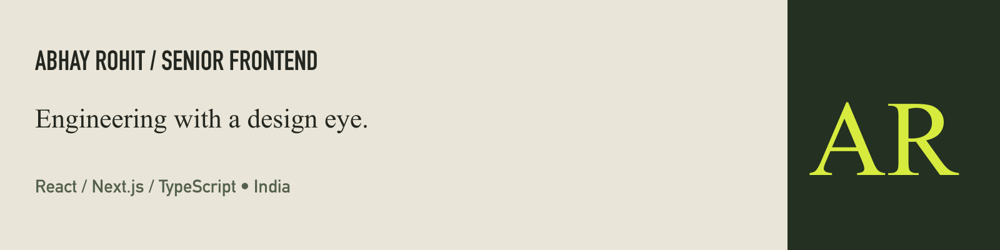

# Abhay Rohit

Senior Frontend Engineer based in Indore, India. I build React, Next.js and TypeScript products and own the work from interface design and architecture through testing, release and production support. Available immediately for India-compatible remote roles; open to hybrid work within India.

[Portfolio](https://abhayrohit.com) · [LinkedIn](https://www.linkedin.com/in/abhayrohit/) · [Email](mailto:hello@abhayrohit.com)

## Production engineering

I was the sole frontend engineer across TBD Health's five-application US telehealth ecosystem, working with backend engineers, product, clinical operations and the CTO. My work covered patient commerce and clinic booking, patient and clinician portals, payments with Stripe/PayPal/Square, healthcare integrations, Playwright/Cucumber testing, Sentry monitoring, CMS/platform migrations and AWS operations.

After Wisp acquired TBD Health, I continued as the frontend domain owner for transition engineering and technical handoff. That contract concluded in July 2026. Employer source code remains private; the [sanitized case study](https://abhayrohit.com/work/tbd-health) explains my responsibility without exposing confidential material.

## Recent public code

| Project | My contribution | Inspect |
| --- | --- | --- |
| 000h by Cojeev | Contributor to registry delivery, appearance reliability and verification tooling, including import-graph payload splitting, first-paint/hydration and cross-tab checks, and Next/Vite consumer verification. The library is built by Sanjay Kumar Gautam. | [Registry contribution](https://github.com/luv-jeri/cojeev-ui/commit/5dfab422518df39cfff2a59395d51284f31fbe05) · [Appearance contribution](https://github.com/luv-jeri/cojeev-ui/commit/cc688334236b3f23bd5d8111d7ab2de7005a366d) · [Public site](https://cojeev.com/ui/) |
| 0dB | Merged React/TypeScript Meter contribution with native semantics, shared tokens, RTL and nine unit/SSR regression tests. Additional component PRs have their own review state. | [Merged Meter PR](https://github.com/luv-jeri/0dB/pull/4) · [My PRs](https://github.com/luv-jeri/0dB/pulls?q=is%3Apr+author%3Ablitzve0) |
| haspr-cursor | Authored and published a browser pointer-interaction and motion package used by the Haspr portfolio. Public releases span 2022–2023. | [Source](https://github.com/hasprLLP/haspr-cursor) · [npm](https://www.npmjs.com/package/haspr-cursor) |
| haspr-rndb | Authored and published an offline database package for React Native and Expo in 2022. | [Source](https://github.com/hasprLLP/haspr-rndb) · [npm](https://www.npmjs.com/package/haspr-rndb) |

## Selected product and creative work

[Browse all seven public showcase studies](showcase/README.md) · [Current résumé](showcase/documents/Abhay_Rohit_Senior_Frontend_Engineer_2026-10-09.pdf) · [Selected projects](showcase/documents/Abhay_Rohit_Selected_Projects_2026-10-09.pdf)

- **[SA Studio](showcase/sa-studio.md):** a studio website in development with Sanjay Kumar Gautam, exploring continuous section journeys, responsive compositions and shared scene handoffs. Private working project.
- **[Human Reviewed Job Search Tool](https://abhayrohit.com/experiments/preflight):** a local Node.js review workspace for public-board discovery, evidence-led India eligibility, explainable form preflight and source-backed answer preparation. Final application decisions and submission remain manual. Private source; public case study.
- **[Vastraveda](showcase/vastraveda.md):** a family saree storefront and operations workflow, including catalogue, cart and checkout engineering. [Public storefront](https://shopvastraveda.com/); payment and sales acceptance are separate from implemented functionality.
- **[Reel OS](https://abhayrohit.com/experiments/reel-os):** a local Python/FFmpeg reel-production workflow with source evidence, validated edit plans, editable OTIO timelines, technical QA and human review. Private source; public case study.
- **[Sienna](https://abhayrohit.com/experiments/sienna):** a local-first personal-assistant prototype with native SwiftUI clients and a private authenticated gateway. Mac preview work includes notes, checklist identity and task/reminder behavior; broader device and voice readiness remain in development.
- **[Instagram creative practice](showcase/instagram-journey.md):** original reels and visual storytelling, with attention to editing, distribution and correctly scoped insight analysis. Public creative work is presented separately from software outcomes.

## Design and collaboration

I previously co-founded Haspr and led frontend engineering and UI/UX from discovery and Figma prototypes through production. The [agency portfolio](https://haspr.in/) received design recognition. I am an [Awwwards Jury Member for 2026](https://www.awwwards.com/jury-member/abhay-rohit).

I use AI coding agents for research, implementation and review while owning technical decisions and verification. I am interested in Senior Frontend Engineer roles, and suitable Product Engineer, Design Engineer and frontend-heavy Full Stack opportunities.

<strong>The Director’s Cut — existing visual portfolio</strong>

<picture>
  <source media="(max-width: 600px)" srcset="assets/directors-cut-mobile-20260925.svg">
  
</picture>

[More studio and production work](PROJECTS.md)

